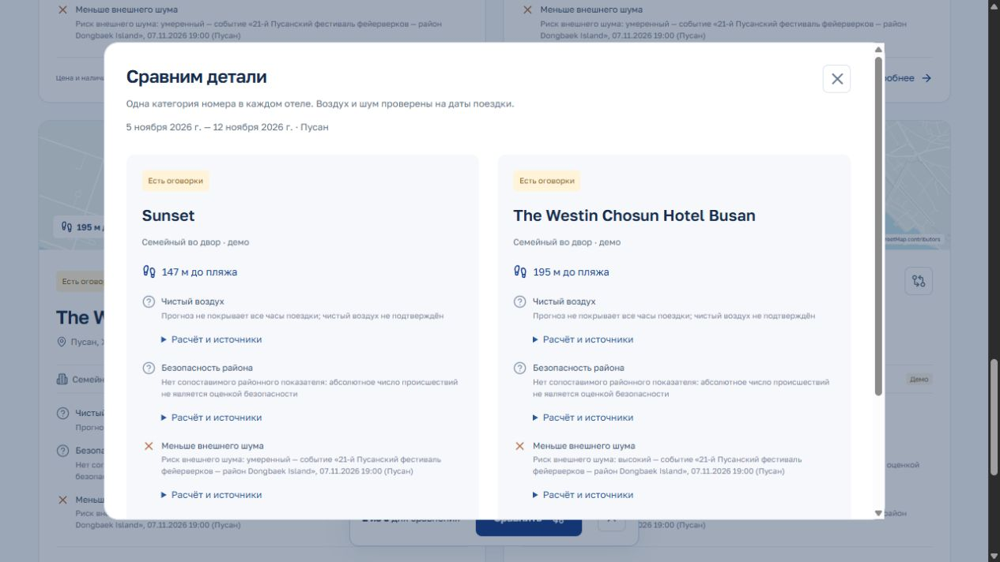

# О!Подойдёт — Пусан

Прототип подбора отелей по проверяемым пожеланиям. Сначала пользователь выбирает **регион, даты и гостей**, затем варианты отдыха, обязательные условия и необязательный текст. Демонстрационная территория — Пусан, район пляжа Хэундэ в Южной Корее.

Отдельный [микросервис вида из окна](services/window-view/README.md) принимает этаж и возвращает JSON с оценкой моря, соседних зданий, достопримечательностей, восхода и заката. Для Хэундэ включён снимок открытых данных; расчёт работает без сети. Python-сервис запускается из `services/window-view` командой `python -m window_view serve`, Java API передаёт запросы через `POST /api/views/estimate`.


Интерфейс: React + TypeScript + Vite. **Бэкенд: Java 21, Spring Boot 3.5.6** (`server/`). **База: PostgreSQL 16 + PostGIS** в Docker (`docker-compose.yml`), схема — миграции Flyway. Node.js используется для интерфейса и скриптов подготовки данных. Устройство бэкенда, ядро знаний, диалог с отельером и контракт API: [server/README.md](server/README.md).

В каталоге 96 именованных объектов OpenStreetMap: 42 отеля, 42 мотеля, 6 хостелов, 4 гостевых дома и 2 объекта апартаментов. Для 95 рассчитан приближённый маршрут до пляжа; у одного маршрут неизвестен. Подтверждены 46 категорий у 6 отелей, для 25 категорий есть семейное назначение. У остальных 90 объектов категория и вместимость неизвестны. По умолчанию используется `data/verified-hotels.json` с политикой `verified-only`; лаборатория с вымышленными объявлениями отделена. [Источники и сбор](docs/VERIFIED_DATA.md), [проверка интеграции](docs/INTEGRATION_QUALITY.md), [проверка слияния кабинетов](docs/MERGE_QUALITY.md). **Внешние цены и наличие номеров не подключены.** У объявлений отельеров есть собственная цена и заявки без оплаты; они отделены от исследовательского каталога. Безопасность района не считается подтверждённой при отсутствии сопоставимых официальных сведений.

## Кабинеты и фотографии

Обновлённый интерфейс FigCraft v2 доступен в основной сборке. Путешественник видит поездки, вопросы, избранное и профиль; отельер управляет объявлениями, заявками и ответами. Этаж и стороны света сохраняются в БД, свободные заметки для подбора доступны только владельцу. Фото можно загрузить с компьютера или добавить по ссылке, просмотреть, переставить и удалить. [Контракт и устройство кабинетов](docs/ACCOUNTS.md).

Для проверки опубликована отдельная вымышленная база кабинетов: **[демонстрационный запуск и пароли](docs/DEMO.md)**. Команды npm run demo:setup и npm run demo:start используют основную сборку на порту 8082 и отдельную схему `demo` в PostgreSQL (учебная SQLite-база переносится туда при первом старте). Рабочая БД и её сессии в Git не включаются.

**Уточнения для подбора:** путешественник задаёт личный вопрос об одном варианте размещения, владелец отвечает с областью действия и сроком перепроверки, затем новый поиск учитывает ответ. История и противоречия сохраняются; в публичную выдачу попадают только обезличенные сведения об условии. [Сценарий, ограничения и API](docs/CLARIFICATIONS.md).

[Проверка качества уточнений](docs/CLARIFICATION_QUALITY.md) описывает исправленные ошибки, расширенную выборку, производительность и ограничения.

## Запуск

### Помощник подбора

На странице результатов появился помощник: агент потребностей → агент подбора → агент-критик. Он объясняет отсутствие совпадений, составляет короткий список и показывает предварительные результаты изменения одного условия. Обязательные условия, даты и состав гостей автоматически не меняются. Агентная часть написана на Python, API и расчёты — на Java 21 (Spring Boot), история — в PostgreSQL. [Запуск, бесплатный режим и устройство](docs/ADVISOR.md).

Для помощника нужен Python 3.11+; путь при необходимости задаётся в `.env` через `ADVISOR_PYTHON`. Он работает без платного API: по умолчанию использует детерминированные роли, опционально — локальную модель Ollama, максимум два вызова за запуск. Обычный подбор работает без Python.

### Тестовая копия с визуализацией ИИ

Лаборатория на **http://127.0.0.1:8081/lab** повторяет страницы основного сайта и позволяет проверить работу каждого агента. Она собирается из той же кодовой базы, но использует отдельные сборку `dist-lab/`, схему `lab` в PostgreSQL и историю браузера. Основной сайт остаётся на порту 8080. [Установка Ollama, запуск обеих копий и инструкция проверки](docs/LOCAL_AI_LAB.md).

Для экспериментов добавлены шесть вымышленных объявлений: подходящее, с несовпадением условия, неполными данными, устаревшими сведениями, противоречивыми источниками и недостаточной вместимостью. Две кнопки запускают опыты только на этих объявлениях: строгий фильтр оставляет один вариант, а перевод требования к окнам во двор в желательное условие даёт модели выбор между несколькими.

Визуализация разделяет **правила Java → выбор локальной модели → проверку моделью-критиком → программную защиту результата**. Для каждого объявления видны допуск, передача модели и итог. Для каждого условия можно сопоставить необходимое предупреждение с фактическим ответом критика: пропуски и лишние замечания не скрываются. Кнопка «Сравнить с правилами» повторяет запуск на том же снимке данных без ИИ. У каждого этапа есть объяснение задачи, способ проверки и реальные входы/выходы.

Ollama и Qwen 2.5 1.5B работают локально, без платы за API. При ошибке модели явно показывается результат по правилам. Веса, рабочие локальные базы, история запусков и `.env` не входят в репозиторий; скрипты установки и настройки включены.


### Приложение

Нужны JDK **21**, Maven **3.9+**, Node.js **24+**, npm и **Docker Desktop** (для PostgreSQL; без Docker укажите свою базу в `DATABASE_URL`). Укажите `JAVA_HOME` на JDK 21; Maven должен быть в `PATH` или `MAVEN_HOME`. На этой рабочей машине также настроен локальный поиск распакованных инструментов в `.local/tools/jdk-21*` и `.local/tools/apache-maven-*`; эти инструменты не входят в репозиторий.

```powershell
npm ci
npm run dev
```

Команда поднимает PostgreSQL в Docker, собирает и запускает Spring Boot API на `http://127.0.0.1:8080`, затем Vite на **http://127.0.0.1:3000**. Изменения интерфейса обновляются автоматически; после изменений Java перезапустите команду. `Ctrl+C` останавливает оба процесса.

Для собранного приложения:

```powershell
npm run build:all
npm start
```

Откройте **http://127.0.0.1:8080**. В этом режиме Spring Boot раздаёт API и файлы `dist/`. Maven создаёт исполняемый `server/target/o-podoydet-server.jar`. Npm-скрипты читают `.env`; переменные окружения имеют приоритет. При прямом `java -jar server/target/o-podoydet-server.jar` запустите базу заранее и передайте настройки PostgreSQL переменными окружения или параметрами Spring.

## База и настройки

При необходимости скопируйте `.env.example` в `.env`. Секреты, локальные базы, сборки и зависимости исключены из Git.

- `PORT` — порт API, по умолчанию `8080`.
- `DATABASE_URL`, `DATABASE_USER`, `DATABASE_PASSWORD` — PostgreSQL; по умолчанию база из `docker-compose.yml`.
- `DB_SCHEMA` — схема копии сайта: основная `public`, лаборатория `lab`, демо `demo`.
- `LEGACY_DB_PATH` — явный однократный импорт прежней SQLite: кабинеты, заявки, фотографии, личные уточнения, история и принадлежность запусков помощника. Исходный файл открывается только для чтения; уже существующие записи PostgreSQL не перезаписываются. Прежний `DB_PATH` сам по себе импорт не включает.
- `DATA_PATH` — исходный каталог для импорта, по умолчанию `data/verified-hotels.json`. Если в старой `.env` указан `data/demo.json`, замените путь и перезапустите сервер.
- `AREA_DATA_PATH` — отчёт района `data/area-assessments.json`.
- `WINDOW_VIEW_URL` — отдельный Python-сервис оценки вида, по умолчанию `http://127.0.0.1:8011`.
- `NOISE_DATA_PATH` — дороги, наблюдения движения и календарь событий `data/noise-context.json`.
- `TRAFFIC_DATA_PATH` — исторические будничные профили движения KTDB, по умолчанию `data/traffic-ktdb-2024.json`.
- `LLM_API_KEY`, `LLM_MODEL`, `LLM_BASE_URL` — необязательный провайдер Responses API. Без ключа и модели работает ограниченный разбор правилами.

Схема базы — миграции Flyway в [server/src/main/resources/db/migration](server/src/main/resources/db/migration). Каталог хранится как доказательства с источником, уверенностью и сроком годности; итоговые факты, противоречия, вопросы отельерам, кабинеты и история помощника — в своих таблицах. При запуске сервер синхронизирует каталог с JSON-снимком: добавляет новые объекты и обновляет исходные данные, сохраняя ответы отельеров и историю. Политика `verified-only` допускает в подбор только географические и официальные свидетельства с источником и датой. Сохранённые demo/host-факты остаются историей, не подтверждая реальные условия. Подтверждение ответа выполняется транзакционно, прежние свидетельства остаются в истории. Для независимой демосессии задайте другую схему `DB_SCHEMA`; для обновления каталога достаточно перезапуска сервера.

Старая `.local/app.sqlite` с Адлером сохраняется на диске и не используется Пусаном. Параметры поиска в браузере также хранятся отдельно от прежней версии.

Основная версия включает авторизацию и отдельные кабинеты путешественника и отельера, объявления, вопросы и заявки. Публикация исходного кода на GitHub не запускает веб-сервис. Сервер по умолчанию слушает только 127.0.0.1; размещение в интернете не выполняется.

## Подбор и уточнения

1. Разбор объединяет выбранные пожелания и необязательный текст; сценарий сам не добавляет скрытых требований.
2. Подбор проверяет условия в одной категории номера, вместимость и обязательность.
3. В режиме «Без известных препятствий» неизвестные или устаревшие обязательные условия допускают вариант с пометкой «Нужно уточнить». Режим «Только подтверждённые» требует положительных сведений. Установленное несоответствие или конфликт обязательного условия исключают вариант в обоих режимах; исходный `evidenceStatus` сохраняется.
4. Географический маршрут берётся из сохранённой карты, условия номера — из официального исследования конкретной категории.
5. В объявлениях владельцев путешественник задаёт вопрос или отправляет заявку. Отельер отвечает и меняет статус в собственном кабинете. Данные владельца отмечены как его сведения, а не независимо подтверждённые факты.

Доступны восемь пожеланий, включая **безопасность района, чистый воздух и меньше внешнего шума**. Они учитываются в ранжировании и сравнении. Желательные условия меняют порядок, обязательные управляют допуском по выбранному режиму. Отсутствие сведений не означает безопасность, тишину или чистый воздух: интерфейс показывает, что нужно уточнить. Оценка района выполняется сервером на даты поездки и не может подтверждаться ответом отельера. [Правила режимов, API и карта](docs/SEARCH_MODES.md).



Планирование проверок детерминированное; реальной отправки сообщений отелям и автономного обхода сайтов нет. Правила поддерживают ограниченные формулировки. Адаптер LLM требует отдельной проверки с реальным провайдером; при сбое используется режим правил с предупреждением.

Тип размещения не подтверждает семейные условия или вместимость, а отсутствие отмеченных лестниц не доказывает доступность с коляской. Для этих утверждений нужны сведения о конкретной категории или маршруте; при нехватке данных используется исходный статус неизвестности. Детальные правила и поля объяснений: [VERIFIED_DATA.md](docs/VERIFIED_DATA.md).

## Оценка района

```powershell
npm run area:assess
npm run area:assess -- --lat 35.16 --lon 129.16 --output .local/one-area.json
```

Первая команда оценивает координаты всех отелей из `data/demo.json`. Отчёт отображается в карточках через `GET /api/areas/:hotelId`.

- **Воздух:** PM2.5, PM10, NO₂ и US AQI из Open-Meteo / CAMS Global. Нужен свежий почасовой прогноз на весь интервал поездки по UTC+9. Условие выполнено при US AQI ≤50 во все покрытые часы. Пропуски или выход за горизонт оставляют неизвестность; текущий AQI не заменяет прогноз. Сетка около 45 км не различает соседние улицы, срок свежести — 6 часов. Сохранены точные ответы 96 запросов с SHA-256.
- **Безопасность:** без достоверных районных сведений выводится «Не оценена». Поддерживается импорт проверенной официальной статистики с полигоном, периодом, источником и методикой. Количество камер, полицейских участков и демографические признаки не используются как заменители преступности.
- В поставке есть официальные сведения полиции о кражах и разбойных нападениях за 2025 год по всему Хэундэ-гу. Граница района отдельно получена из OSM; её историческое соответствие 2025 году не подтверждено. Это исходные районные показатели, а не вероятность происшествия у отеля.
- Ошибка источника или пропуск не превращаются в нулевое загрязнение либо положительную оценку безопасности. Общий балл района не вычисляется.

Для пожелания безопасности требуется официальный показатель на 100 тысяч жителей и сопоставимый региональный ориентир с одинаковыми периодом, категорией и методикой. В поставке есть только абсолютные числа: исходная сравнительная оценка неизвестна, бинарный статус критерия — `mismatch` с `assumed: true`. Это не утверждение, что район опасен. В режиме `explore` такой обязательный критерий допускает предварительный вариант, в `verified` — исключает его.

**Внешний шум** зависит от расстояния до дорог, датированных наблюдений движения и местных событий, пересекающихся с поездкой. Класс дороги не заменяет измерение загруженности; частичный календарь не доказывает отсутствие праздников. Расчёт показывает риск, а не децибелы в номере. Подготовка: `npm run noise:assess`. Формат источников и ограничения: [NOISE.md](docs/NOISE.md).

В поставку входят исторические будничные подсчёты KTDB за 2024 год: 10 участков, 184 часовых значения; 72 объекта в пределах 300 м от линий. История и расстояние до дороги показывают фон, но не подтверждают тишину на даты поездки. Дополнительно извлечены реальные годовые измерения на пяти постах Пусана из официального отчёта за 2025 год; без проверенной связи с отелем они не участвуют в фильтре. [Шум и источники](docs/NOISE.md), [трафик](docs/TRAFFIC.md).

```powershell
npm run traffic:fetch
npm run traffic:fetch -- --refresh
```

Первая команда использует сохранённый проверенный кеш; вторая запрашивает официальный публичный слой заново. Для обычного запуска обновлять снимки не требуется.

Форматы импорта, кеш, offline-режим, происхождение данных и ограничения описаны в [AREA_ASSESSMENT.md](docs/AREA_ASSESSMENT.md).

## Геоданные

Подготовленный снимок Пусана включён в репозиторий и используется для расчётов и запасной схемы. Основная интерактивная карта Leaflet загружает подложку OpenStreetMap с подписями улиц; для неё нужен интернет. Можно переключиться на сохранённую схему. Подложка не обновляет рассчитанные маршруты автоматически.

```powershell
npm run data:fetch
npm run data:prepare
npm run area:assess
npm run noise:assess
npm run traffic:fetch
```

`npm run data:prepare` пересобирает географическую основу `data/demo.json`, затем рабочий `data/verified-hotels.json`. Для пересборки рабочего каталога из сохранённой географии и двух файлов исследования достаточно `npm run data:verify`; эта команда не обходит сайты и не продлевает даты проверки.

Скрипт загрузки ограничен районом Хэундэ и использует кеш с именем региона. Подготовка сохраняет пять типов размещения и строит маршруты до приближённого подхода к пляжу по связному пешеходному графу. Объект без допустимого маршрута остаётся в каталоге с `route: null` и без подтверждённого расстояния. Для применения изменений каталога перезапустите сервер; отдельная схема базы нужна только для чистой демонстрации без истории ответов.

Входы в отели и подходы к пляжу не обследованы. Соединительные участки до сети не включены в длину маршрута. Отсутствие лестниц на карте не доказывает доступность для коляски. Окружение показывает возможные источники шума, а не акустические измерения. Названия и расположение объектов реальны, их действующая работа не проверена.

Данные © [OpenStreetMap contributors](https://www.openstreetmap.org/copyright), [ODbL 1.0](https://opendatacommons.org/licenses/odbl/1-0/). Подробнее: [data/README.md](data/README.md). Воздух: Open-Meteo и CAMS, атрибуция и условия сохранены в отчёте района.

## Проверки и структура

Локальный ИИ без платы за API и отдельная копия сайта с визуализацией работы агентов: [запуск лаборатории](docs/LOCAL_AI_LAB.md). Основной сайт работает на порту 8080, копия с `/lab` — на 8081.

```powershell
npm run check
npm test
npm run backend:test
npm run agents:test
npm run demo:test
npm run build:all
npm run lab:build
```

Java-тесты используют PostgreSQL 16 в одноразовом контейнере. Для своей тестовой базы задайте
`TEST_DATABASE_URL` (JDBC), `TEST_DATABASE_USER` и `TEST_DATABASE_PASSWORD`: проверки создают
отдельные временные схемы. После первоначального скачивания зависимостей и Docker-образа
сборка и проверки работают на сохранённых данных без внешних API и ключей.

Проверка личных пожеланий на запущенной отдельной тестовой копии:

```powershell
python -X utf8 scripts/verify-personal-wishes.py --base http://127.0.0.1:8090 --report .local/wishes-map/personal-http.json
```

Она проверяет распознавание текста отдельно от выбранных фильтров, согласованность карточки
и страницы отеля, неизвестные этаж/окна и сообщения помощника. Полный результат этого
изменения: [карта и личные пожелания](docs/PERSONAL_WISHES_QUALITY.md).

`server/` — Spring Boot API, PostgreSQL и тесты; `contract/` — эталонные ответы API (`npm run contract:verify`); `agents/` — Python-агенты и их тесты; `src/` — интерфейс; `shared/` — типы и вычисления интерфейса/скриптов; `scripts/` — данные, оценка района и запуск; `tests/` — TypeScript-проверки; `data/` — воспроизводимые снимки.

[Архитектура](docs/ARCHITECTURE.md) · [Проверенные данные](docs/VERIFIED_DATA.md) · [Концепция](CONCEPT.md) · [Реализация и ограничения](docs/IMPLEMENTATION.md) · [Ручная приёмка](docs/ACCEPTANCE.md)
