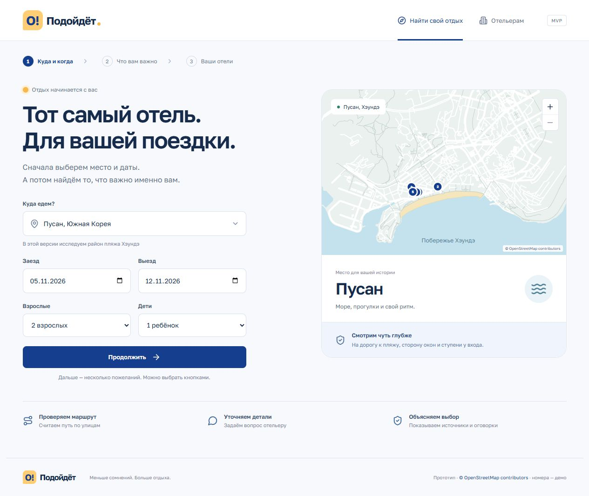

# О!Подойдёт

Отдельный микросервис оценки вида из окна находится в
[`services/window-view`](services/window-view/README.md): JSON API, входной этаж,
геометрия окна и соседних зданий, море, достопримечательности, восход/закат,
открытые источники и явные неизвестные. Запуск: из его папки
`python -m window_view serve`. Клиент для сервера —
[`server/window-view-client.ts`](server/window-view-client.ts).



Локальный MVP подбора отелей по проверяемым пожеланиям. Сначала пользователь указывает **регион, даты и состав гостей**, затем выбирает сценарии отдыха и отдельные пожелания. Свободный текст необязателен. Исходная концепция — [CONCEPT.md](CONCEPT.md).

Демонстрационная территория — прибрежная часть Адлера. В подготовленной базе 24 реальных объекта размещения из OSM и 136 исходных фактов, включая вымышленные сведения о номерах. Сервис сопоставляет пожелания с конкретной категорией номера, показывает источники и неизвестные условия, позволяет задать вопрос в демонстрационный кабинет отельера и сохранить подтверждённый оператором ответ.

**Это прототип, а не система бронирования:** свободные номера, цены и возможность заселиться на выбранные даты не проверяются. География основана на OpenStreetMap; категории номеров, их вместимость и ответы в кабинете вымышлены и помечаются как демонстрационные. Они не являются заявлениями настоящих отелей.

## Быстрый запуск

Требуется Node.js **24 или новее** и npm. Python, отдельный сервер базы данных и API-ключ для базового режима не нужны.

Из корня проекта:

```powershell
npm ci
npm run dev
```

Откройте [http://127.0.0.1:3000](http://127.0.0.1:3000). Сервер Express обслуживает API и Vite в одном процессе. По умолчанию он слушает только `127.0.0.1`. Предупреждение Node об экспериментальном `node:sqlite` допустимо и само по себе не означает ошибку запуска.

Для запуска используется подготовленный `data/demo.json`. Сеть нужна для первоначальной установки зависимостей; поиск по сохранённым данным и режим правил не требуют внешней модели или новых запросов к OSM. Если `data/demo.json` отсутствует, сначала подготовьте данные по инструкции ниже.

Для проверки сборки и запуска собранного интерфейса:

```powershell
npm run build
npm start
```

Перед сменой режима остановите предыдущий сервер через `Ctrl+C`, чтобы освободить порт.

## Настройки и хранение

При необходимости скопируйте `.env.example` в `.env`. Не добавляйте ключи в репозиторий. Настройки читаются сервером при старте.

- `PORT` — локальный порт, по умолчанию `3000`.
- `DB_PATH` — путь к SQLite, по умолчанию `.local/app.sqlite`. Родительская папка пользовательского пути должна существовать.
- `LLM_API_KEY`, `LLM_MODEL` — оба значения включают обращения к языковой модели.
- `LLM_BASE_URL` — базовый адрес API; по умолчанию `https://api.openai.com/v1`.

В SQLite сохраняются факты, вопросы и черновики ответов. При первом запуске загружаются факты из `data/demo.json`; последующие запуски сохраняют изменения оператора. Изменение исходного JSON не перезаписывает факты с уже существующими идентификаторами в базе.

Для новой независимой демонстрации задайте другой `DB_PATH`, например `.local/demo-2.sqlite`, и перезапустите сервер. Это сохраняет предыдущую сессию. Каталог `.local` исключён из Git.

Кабинет отельера предназначен для одного локального оператора. В нём нет аутентификации и настоящей отправки сообщений отелям. Перед публичным размещением нужны отдельные права доступа, защита кабинета и работа с реальными отельерами.

## Как устроен подбор

Стек: React + TypeScript + Vite для интерфейса, Express + TypeScript для API, встроенный `node:sqlite` для хранения, собственные географические функции на TypeScript. Нет отдельного Python-сервиса или обязательного агентного фреймворка.

1. **Разбор запроса** объединяет выбранные пожелания и необязательный текст. Сценарии подсказывают пожелания, но сами не добавляют скрытых ограничений.
2. **Подбор кодом** проверяет условия в пределах одной категории номера. Преимущества разных категорий не объединяются. Подтверждённое нарушение обязательного условия исключает вариант; неизвестное условие требует уточнения.
3. **Планирование уточнения** проверяет характеристику и выбирает локальные геоданные либо вопрос отельеру. Повторный открытый вопрос для той же категории и характеристики не создаётся.
4. **Извлечение ответа** формирует предварительный факт с цитатой. Оператор проверяет результат перед сохранением; неоднозначный ответ не должен превращаться в утверждение.
5. **Проверка доказательств** учитывает источник, область действия, актуальность и конфликт. При явном разрешении конфликта прежняя версия остаётся в истории.

Без LLM действуют ограниченные, видимые пользователю правила распознавания русского текста. Это воспроизводимый режим демонстрации, а не полноценное понимание любых формулировок. Проверяйте распознанные пожелания и предварительные факты.

Опциональный LLM-адаптер отправляет структурированные запросы на `POST {LLM_BASE_URL}/responses`, ожидает поддержку JSON Schema и проверяет ответ через Zod. Подключение только к Chat Completions без `/responses` недостаточно. При ошибке или тайм-ауте используется режим правил с предупреждением. Текст пожеланий и ответы оператора могут передаваться настроенному провайдеру; ключ остаётся на сервере. Интеграция с реальным ключом должна проверяться отдельно от локального режима.

## Геоданные и их обновление

`scripts/fetch-osm.ts` получает ограниченную выгрузку района через Overpass API и сохраняет её в `data/osm-snapshot.json`. Части выгрузки кешируются в `data/osm-part-*.json`. Повторный запуск может использовать кеш: это не гарантирует свежую загрузку всех объектов. Проверяйте дату исходной базы OSM, а не только время подготовки файла.

`scripts/prepare-data.ts` строит пешеходный граф, выбирает отели с найденным путём к пляжу, рассчитывает маршруты и окружение, добавляет явно демонстрационные категории номеров. Текущая выгрузка содержит 4 148 объектов OSM, пешеходный граф — 11 896 узлов; подготовлены 24 отеля и 136 исходных фактов. При новом снимке покрытие может измениться. Подробности — в [описании данных](data/README.md).

```powershell
npm run data:fetch
npm run data:prepare
```

Для пересчёта из уже сохранённого снимка достаточно `npm run data:prepare`. Получение нового снимка требует сети и доступности Overpass. При обновлении данных используйте новую локальную базу, если нужно проверить новые исходные факты без истории прежней демонстрации.

Ограничения георасчётов:

- Точки входа в отель и подхода к пляжу приближённые, не обследованы на месте. Длина относится к пути по графу; соединительные участки до него не включены. Наличие пути на карте не гарантирует публичный доступ или отсутствие ограждений.
- Обход лестниц исключает известные лестницы в пределах снимка. Отсутствие отмеченных препятствий не доказывает доступность с коляской.
- Окружение показывает факторы возможного шума, а не измеренные децибелы. Расстояния до линейных объектов оцениваются до ближайшей точки сегментов сохранённой геометрии; это не акустическая модель.
- Сторона окон во двор не гарантирует тишину. Демонстрационные сведения о номерах не заменяют реального подтверждения отеля.
- Даты влияют на применимость сведений при наличии соответствующего периода, но не подтверждают наличие номеров и не покрывают неизвестные сезонные ограничения.

Данные © [участники OpenStreetMap](https://www.openstreetmap.org/copyright), [ODbL 1.0](https://opendatacommons.org/licenses/odbl/1-0/). При распространении снимка или производной базы сохраняйте атрибуцию и соблюдайте условия ODbL. Вымышленные сведения о номерах добавлены приложением и не являются данными OSM.

## Структура проекта

- `src/` — пользовательский интерфейс.
- `server/` — API, разбор запросов и ответов, SQLite.
- `shared/` — типы, каталог характеристик, валидация, подбор и геофункции.
- `scripts/` — загрузка и подготовка снимка.
- `data/` — сохранённые исходные и подготовленные данные.
- `tests/` — автоматические проверки логики.
- `docs/ACCEPTANCE.md` — сценарии ручной приёмки.
- `docs/IMPLEMENTATION.md` — выполненные функции, результаты проверок и оставшиеся ограничения.

## Проверка

```powershell
npm run check
npm test
npm run build
```

На 24 октября 2026 года успешно выполнены сборка с проверкой TypeScript и 23 автоматических теста. В браузере пройден основной цикл от дат и пожеланий до подтверждения ответа отельера и обновления карточки. Подробности и границы проверки — в [отчёте реализации](docs/IMPLEMENTATION.md). Для повторной ручной проверки используйте [приёмочные сценарии](docs/ACCEPTANCE.md).
