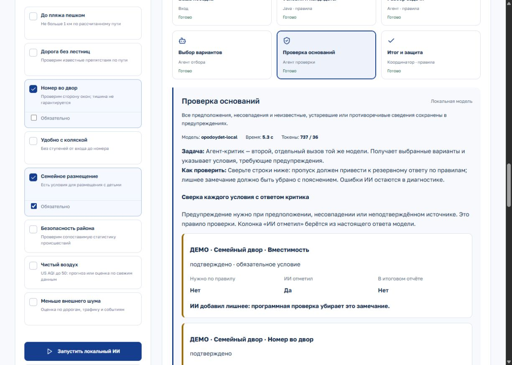

# Локальный ИИ и лабораторная копия

Лаборатория повторяет все страницы сайта и добавляет `/lab`: редактирование поездки, три сценария проверки, схему обработки, реальные входы и ответы агентов, время, токены, сравнение с правилами, историю и заметки с экспортом JSON.

## Новые кабинеты и интерфейс

На главной странице тестовой копии (`http://127.0.0.1:8081/`) доступны обновлённый поиск, регистрация путешественника или отельера и объявления. Путешественник видит поездки, свои вопросы и профиль. Отельер создаёт объявления, отвечает гостям и управляет заявками. Сведения сохраняются в базе лаборатории; оплата не подключена. Проверенный каталог и объявления владельцев разделены.

В редакторе объявления есть закрытый раздел «Данные для ИИ»: свободный текст до 6000 символов. Этаж и направления окон — отдельные публичные поля. Объявления участвуют в общем поиске по сведениям отельера; закрытый текст не показывается гостям, а публичные поля сопровождаются указанием источника. Ограничения разбора текста и разделение публичного/закрытого API описаны в [ACCOUNTS.md](ACCOUNTS.md).

Для обновления только тестовой копии выполните `npm run backend:build`, затем `npm run lab:build` и `npm run lab:start`. Команда `npm run build` для этой проверки не нужна: она перезаписывает сборку основного сайта. Кабинеты и объявления доступны также в основной версии; `LAB_MODE=true` включает только лабораторные эксперименты. Для лаборатории используются отдельная схема PostgreSQL `lab` и папка фотографий `.local/lab-uploads` (настраивается `LAB_UPLOADS_PATH`).

Ранее открытый демонстрационный кабинет с редактированием любых отелей заменён в тестовой копии кабинетом с проверкой владельца. Вопросы и ответы нового кабинета относятся к собственным объявлениям, поэтому не меняют доказательства в исследовательском каталоге. Эксперименты `/lab` продолжают использовать подготовленные учебные данные. [Контракт и проверка кабинетов](ACCOUNTS.md).

## Тестовые объявления

При `npm run lab:start` создаётся `.local/lab-hotels.json`: исходный каталог плюс шесть вымышленных объявлений с префиксом «ДЕМО». Они доступны в галерее лаборатории, обычной выдаче, карточке отеля и агентном контексте. Сценарии: совпадение условий, несовпадение, отсутствие данных, устаревшие сведения, конфликт источников, недостаточная вместимость. Для сравнения используйте две обязательные характеристики — семейное размещение и окна во двор — и состав 2 взрослых + 1 ребёнок.

В лабораторном каталоге включена существующая политика `demo`: учебные факты и тестовые ответы отельера участвуют в подборе. Основной каталог сохраняет `verified-only`. Карта и источники синтетических объявлений не выдаются за настоящие: адреса условные, реальные OSM-ссылки и сведения о районе отсутствуют. Исходный файл данных не изменяется. Изменения ответов отельера сохраняются в базе копии, поэтому после ручных экспериментов результат может отличаться от первоначальных примеров.

## Уже выбранная конфигурация

- Java 21 и Spring Boot 3.5.6 обслуживают API, проверяют условия и хранят историю в PostgreSQL 16; схема лаборатории отделена от основного сайта.
- Python 3.11+ вызывает локальную модель два раза: отбор вариантов и независимая проверка. Сторонние Python-пакеты не требуются.
- Ollama `v0.40.10`, Qwen 2.5 1.5B (веса около 986 МБ), проектное имя `opodoydet-local`. Контекст 8192 токена, до 1200 выходных токенов, шесть CPU-потоков, один запрос одновременно.
- Платного API нет. Ollama слушает только `127.0.0.1:11434`, облачные функции выключены. Лаборатория также отключает необязательный платный разбор текста поиска, даже если для основного сайта в `.env` есть ключ.

Это небольшая модель для демонстрации на компьютере с 16 ГБ памяти. Она может ошибаться и пропускать предупреждения; такой ответ отклоняется проверкой и явно маркируется `rules_fallback`. Модель не определяет доступность номеров, не придумывает факты и не меняет обязательные условия. Координатор и расчёт условий остаются детерминированными. Диагностика показывает наблюдаемые данные и ответы, а не скрытый ход мыслей модели.

Если критик отмечает лишние подтверждённые условия, программная проверка убирает их из итоговых предупреждений и явно сообщает об этом. Исходный ответ модели остаётся доступным для оценки качества.

## Установка на другом компьютере Windows

Предварительно установите JDK 21, Maven 3.9+, Node.js 24+, Python 3.11+ и PostgreSQL 16 (через Docker Desktop или собственный `DATABASE_URL`) согласно [README](../README.md#приложение), выполните `npm ci` и скопируйте `.env.example` в `.env`, если своего файла настроек ещё нет.

Из корня проекта:

```powershell
powershell -NoProfile -ExecutionPolicy Bypass -File scripts/install-ollama.ps1
npm run ollama:start
```

Первый скрипт скачивает portable-архив с официального релиза и проверяет SHA-256. Сервер остаётся в первом терминале. В другом терминале:

```powershell
npm run ollama:prepare
```

В `.env` укажите существующий Python и имя подготовленной модели:

```dotenv
ADVISOR_PYTHON=python
ADVISOR_LOCAL_MODEL=opodoydet-local
ADVISOR_LOCAL_BASE_URL=http://127.0.0.1:11434/v1
```

Если Python отсутствует в PATH, используйте абсолютный путь к `python.exe`. При первом запуске Ollama создаёт служебный ключ в `%USERPROFILE%/.ollama`; веса, программа и данные лаборатории находятся в игнорируемой Git папке `.local`. Установка не меняет системный PATH. Интернет нужен для скачивания программы и весов, затем агентные запросы выполняются локально.

## Запуск двух сайтов

```powershell
npm run build:all
npm run lab:build
npm start
```

В отдельном терминале:

```powershell
npm run lab:start
```

Основной сайт: <http://127.0.0.1:8080>. Лаборатория: <http://127.0.0.1:8081/lab>. У копии отдельные `dist-lab`, схема PostgreSQL `lab`, папка загрузок и хранилище браузера благодаря другому порту. `DB_SCHEMA` применяется также при явно заданном `DATABASE_URL`. Это та же кодовая база, поэтому исправления общих страниц не расходятся между двумя копиями. Лабораторный маршрут включён только в специальной сборке.

Для следующего запуска повторная установка и сборка не нужны: запустите `npm run ollama:start`, `npm start` и `npm run lab:start` в трёх терминалах. Остановка: Ctrl+C в соответствующем терминале. Порт и схему копии можно изменить через `LAB_PORT` и `LAB_DB_SCHEMA`. Для переноса прежних данных необходимо явно задать `LAB_LEGACY_DB_PATH`; обычный запуск не импортирует рабочую SQLite другого сайта.

## Как проверить и предложить изменения

На странице есть блок «Где здесь ИИ и как его проверить». Он отделяет детерминированную проверку Java, правила координатора/потребностей, два модельных вызова и шаблонный итоговый текст.

Доступны два опыта только на шести учебных объявлениях. Их снимки не содержат реальные отели; обычные кнопки формы по-прежнему проверяют весь каталог:

- «Подобрать по тестовым условиям»: окна во двор обязательны; исходные данные обычно оставляют одно учебное объявление. Страница прямо отмечает отсутствие выбора между альтернативами.
- «Проверить выбор и критику ИИ»: меняется только обязательность окон во двор. Несколько вариантов с разным качеством доказательств остаются допустимыми; это проверяет реальный выбор и работу критика.

В этапе «Условия и кандидаты» выберите любое из шести объявлений. Три колонки показывают решение Java, передачу/выбор модели и окончательный результат. Эти данные берутся из того же снимка, что запуск, включая исключённые объекты. Они не добавляются в пул модели. На этапе «Проверка оснований» каждое условие сверяется по трём признакам: нужно ли предупреждение по правилу, отметил ли его ИИ, сохранилось ли оно в итоге. Пропуски и лишние замечания видны отдельно.

Короткие ID расшифровываются через сохранённую служебную карту `diagnostic.references`, а не угадываются по названиям. Карта не передаётся модели и не расходует её контекст. У старых запусков без карты или `testCases` отображается пояснение о необходимости нового эксперимента.

1. Откройте лабораторию и нажмите «Проверить выбор и критику ИИ» для опыта на учебных объявлениях. Для проверки всего каталога выберите «Есть варианты» в форме и нажмите запуск локального ИИ.
2. Дождитесь отбора и проверки. Подтверждение реальной работы: `execution=local`, два завершённых модельных вызова, фактические токены и ответы в этапах агентов.
3. Нажмите «Сравнить с правилами». Оба запуска используют один `searchId`, одинаковые условия и снимок данных. Снимок доступен 10 минут после поиска; позднее нужно запустить новый подбор.
4. Попробуйте отсутствие совпадений и противоречие. При противоречии рекомендации блокируются до вызова модели, это намеренно показывается как работа правил.
5. Выберите этап схемы, раскройте вход/выход, запишите, что изменить, и экспортируйте JSON. Заметки хранятся в этом браузере; история запусков — в базе копии. Ничего не отправляется разработчику автоматически.
6. Блок остальных проверок открывает обычный подбор, сравнение, карты, доказательства и кабинет отельера в этой же копии.

Вызов ограничен 180 секундами, Python-процесс — 420 секундами. После ошибки нет автоматических повторов. При отмене Java останавливает Python и игнорирует поздний ответ; Ollama может ещё кратко завершать уже принятый запрос. Занятый CPU и недостаток свободной памяти увеличивают время.

Официальные источники: [Ollama для Windows](https://docs.ollama.com/windows), [локальный режим и настройки](https://docs.ollama.com/faq), [модель Qwen 2.5 1.5B](https://ollama.com/library/qwen2.5:1.5b).

## Историческая проверка локальной модели

Следующие результаты относятся к запуску 24 октября до переноса сервера на Spring/PostgreSQL. Они описывают наблюдения за моделью и не являются результатами текущего регрессионного прогона Spring.

24 октября 2026 года проверены реальные запуски на Ryzen 7 5700U с 16 ГБ RAM. Обычный подбор на окончательном формате ответа завершил два вызова с `execution=local` примерно за 10 секунд; первый холодный запуск занимал около 27 секунд. Сценарий без совпадений на части проверок проходил, но на финальном прогоне модель пропустила обязательные предупреждения: два реальных вызова за 9 секунд, затем `rules_fallback`. Это известное ограничение качества модели 1.5B, а не успешный ИИ-результат. Проверки не ослаблялись. Скорость также не гарантируется. Ollama подтвердил CPU-исполнение (`size_vram=0`). Противоречивые пожелания завершились уточнением без вызова модели. Контроль по правилам использовал тот же снимок, отдельные базы основного сайта и копии проверены через API.

Автоматические проверки: 80 TypeScript, 59 Java и 28 Python тестов; обе сборки интерфейса и сборка Java прошли. Живая проверка дополнительно выявила и помогла исправить путаницу ссылок у маленькой модели и преждевременные статусы этапов в интерфейсе. Тестовый подбор шести вымышленных объявлений выбрал «Семейный двор» двумя реальными локальными вызовами примерно за 8 секунд.

В отдельном опыте с желательными окнами во двор Java допустила пять из шести учебных объявлений, исключив номер на двоих для трёх гостей. Модель выбрала «Семейный двор», «Окна на улицу» и «Два разных ответа». Критик сохранил оба необходимых предупреждения, но добавил пять лишних; программная проверка убрала их и оставила исходный ответ в диагностике. Выполнены два локальных вызова, результат помечен `execution=local`. Контроль без ИИ на том же `searchId` сделал ноль вызовов и выбрал те же варианты в том же порядке. Совпадение не доказывает преимущество модели; интерфейс прямо сообщает об этом. Результаты относятся к этому прогону, а не гарантируются при каждом повторе.



Тестовый `POST /api/lab/search` доступен только при `LAB_MODE=true`, который устанавливает `npm run lab:start`. Он создаёт обычный снимок поиска, предварительно ограничив каталог и факты синтетическими объявлениями. На основном сервере этот маршрут возвращает 404. Обычный `/api/search` в лаборатории продолжает работать со всем её каталогом.


## Отдельная демонстрация диалога v2

Обычная лаборатория `/lab` сохраняет работу кабинетов и опытов помощника. Экспериментальные `/api/v2/questions/*` имеют дополнительную границу: разрешены только `LAB_MODE=true`, политика каталога `demo` и явно вымышленные гостиницы `demo-*` с `demo=true`. Реальным объектам Пусана нельзя приписывать ответы имитированного отельера.

Для этого потока подготовлен отдельный `data/demo/spring-host-dialog.json`; команды запуска и API приведены в [server/README.md](../server/README.md#вымышленный-диалог-для-демонстрации). Используйте отдельную схему `host_dialog_demo`, чтобы он не заменял каталог и историю основной лаборатории.

Результаты актуальной проверки Spring/PostgreSQL и ограничения: [SPRING_MIGRATION_QUALITY.md](SPRING_MIGRATION_QUALITY.md).
