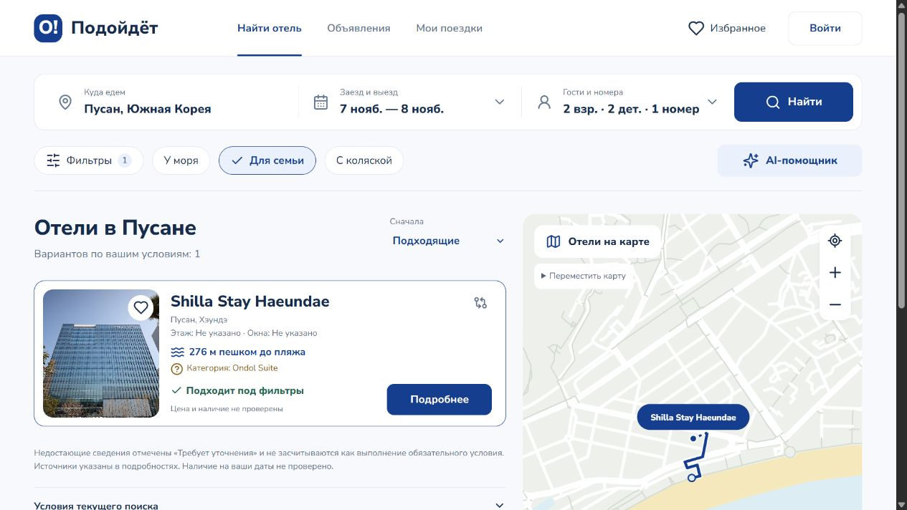

# Проверка слияния с обновлением кабинетов, 25 октября 2026

Ветка `feat/busan-data-and-window-view` объединяет нашу версию `188af19`
с `main` на `55af264` (дизайн, кабинеты, объявления, фотографии и отдельная демо-база).
Слияние выполнено с двумя родителями; изменения основной ветки сохранены.

## Что совмещено

- React-дизайн, карта, фильтры, избранное, боковая панель помощника и карточки.
- Аккаунты путешественника/отельера, объявления с этажом и сторонами света,
  загрузка и порядок фотографий, вопросы и заявки без оплаты.
- Наши 96 объектов Пусана, 46 официальных категорий, парсеры и происхождение данных.
- Неизвестные вместимость/условия отдельно от установленного несоответствия.
- Python window-view и Java-маршрут `POST /api/views/estimate` вместе с AccountApi.
- Отдельные рабочая, лабораторная и синтетическая демо-базы и папки загрузок.

Вручную разрешены четыре конфликта: README, package.json, Api.java и ResultsPage.tsx.
При семантической проверке исправлены подписи неизвестных условий и подсчёт
подтверждённых пожеланий в новых карточках/сравнении. Фото сопровождаются источником
и оговоркой, что они не подтверждают конкретный номер. Проверка браузером дополнительно
исправила склонение счётчика и подпись категории: найденная Ondol Suite отображается
по имени, без ложного сообщения о неизвестной категории.

## Проверки

| Набор | Результат |
|---|---|
| TypeScript, включая 6 регрессий представления/фото | 119/119 |
| Java, включая accounts/photos/owner search/window-view | 93/93 |
| Python window-view | 182/182 |
| Python помощник | 28/28 |
| Python парсер шума | 5/5 |
| Node demo SQLite | 4/4 |
| TypeScript typecheck, Vite main и lab, Java JAR | прошли |

Всего 431 автоматический тест. Java total взят из текущего запуска; два старых
XML-отчёта от предыдущих имён пакетов в локальном target не учитывались.

[Поиск через настоящий HTTP](HTTP_MERGE_REPORT.json): 102 запроса, 9 792 классификации,
три состава гостей, восемь обязательных/желательных условий, два интервала дат,
реальные категории, независимая лаборатория, четыре запуска помощника по правилам.
Также проверен вызов Java → Python для реального отеля и двух синтетических этажей.
Базы, загрузки и история помощника изолированы; исходные снимки связаны с SHA-256.

[Кабинеты через настоящий HTTP](ACCOUNTS_HTTP_REPORT.json): 56 запросов, три вымышленных
аккаунта, черновик/публикация, этаж/направления, две PNG-фотографии, семь проверок
декодированных пикселей, удаление метаданных, изменение порядка/удаление из объявления,
перезапуск и сохранность данных, вопросы/ответы, подтверждение/отмена тестовой заявки.
Проверены запреты для анонимного пользователя, другой роли и чужого владельца,
отсутствие закрытых заметок в публичном поиске. Реальных внешних заявок не создавалось.

Расширенный [набор window-view](../services/window-view/data/busan-quality.json)
повторно прошёл в 10:36 UTC: 288/288 запросов по 96 объектам, 87 552 оценки точек.
Все неизвестные реальные виды остались неизвестными; проверок физических номеров на месте нет.

В браузере проверены новый дизайн, семейный поиск 2 взрослых + 2 ребёнка на 7–8 ноября,
Shilla Stay / Ondol Suite, переход к выбранной категории, четыре места, источники,
нейтральные неизвестные условия, отдельные сведения по воздуху/безопасности и запуск
помощника по правилам. Скриншот:



## Повторить

```powershell
npm test
npm run backend:test
npm run agents:test
npm run demo:test
npm run build:all
npm run lab:build
python -X utf8 -m unittest discover -s scripts/tests
python -X utf8 scripts/verify-http-integration.py --report docs/HTTP_MERGE_REPORT.json
python -X utf8 scripts/verify-accounts-integration.py
```

Из `services/window-view`:

```powershell
python -m unittest discover -s tests
python verify_busan.py --workers 4
```

HTTP-сценарии используют свежие БД и UPLOADS_PATH под `.local`, выключают платный LLM
и сами останавливают свои серверы. `--keep-running` у общего сценария оставляет
процессы для ручной проверки; их PID/пути записаны в `.local/http-smoke/<run>/processes.json`.
Исходный `data/demo/preview.sqlite3` проверен без изменения байтов.

Ограничения прежние: геометрическая оценка не подтверждает реальный вид, доступность
номера на даты не подключена, исторические измерения шума не являются измерением у отеля.
В этом прогоне проверялся помощник по правилам; качество локальной LLM отдельно не оценивалось.
