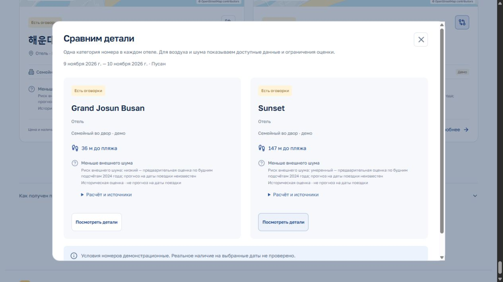

# Открытые данные движения Пусана

В `data/traffic-ktdb-2024.json` сохранены **10 исторических будничных профилей с 184 почасовыми значениями**. Это реально полученные данные официального Korea Transport Database (KTDB), Korea Transport Institute, без API-ключа. Источник — [View-T 3.0](https://viewt.ktdb.go.kr/cong/map/second_map.do?sendIp=2024), слой `Link_ObservedTrafficVolume_total_weekday`, год 2024. Слой `EstimatedTrafficVolume` не использован.

## Что можно утверждать

Источник возвращает дорожные участки со своей геометрией и подсчётами автомобилей. Выгрузка ограничена Хэундэ: west 129.145, south 35.150, east 129.180, north 35.175. Получено 86 участков; у 76 значения отсутствуют. Три профиля покрывают 24 часа, семь — 06:00–22:00. Отсутствие подсчёта не означает нулевое движение.

Поля `t01`…`t24` соответствуют часовым интервалам 00:00–01:00…23:00–24:00 по Корее. Это соответствие показано в выпадающем списке `to_timezone` официальной страницы. Маркер `-1000` нормализован в `null`.

Название исходного поля `aadt` не даёт права называть каждое его значение полным среднесуточным объёмом: в этой выгрузке оно равно сумме доступных часов, в том числе только 16 часов. Поэтому нормализованное поле называется `reportedTotal`. Например, у link `8207700` опубликовано 5846 автомобилей за доступные часы, а не доказанный средний объём за 24 часа.

Точная дата обследования, количество дней выборки, число полос и охват направлений в ответе не указаны. Сохранён год профиля; вымышленных дат наблюдения нет. Порядок координат линии не доказывает направление подсчёта. Исторические значения нельзя выдавать за движение сегодня или на даты будущей поездки.

## Воспроизводимость

```powershell
node --import tsx scripts/fetch-traffic.ts
node --import tsx scripts/fetch-traffic.ts --refresh
node --import tsx --test tests/traffic.test.ts
```

Без флага используется проверенный локальный кеш. `--refresh` делает один ограниченный публичный WFS-запрос. Запрос построен по слою и параметрам официального интерфейса; это публичный интерфейс карты, не обещание стабильного API. Его структура может измениться.

- `data/traffic-ktdb-2024.raw.geojson` — исходный ответ без подмены значений.
- `data/traffic-ktdb-2024.provenance.json` — точный URL запроса, издатель, время получения и SHA-256 исходного ответа.
- `data/traffic-ktdb-2024.json` — проверенные профили, геометрии, ограничения и частичное покрытие.

Скрипт проверяет систему координат, регион, полноту ограниченного ответа, уникальность link ID, 24 часовых поля, маркеры пропусков и равенство суммы опубликованному итогу. HTML ошибки, неполные ответы и неожиданная семантика счётчиков не заменяют сохранённый набор. Ключи и авторизация не используются.

## Контракт для модели

Корень содержит `schemaVersion: 1`, `region: "Пусан"`, `referenceYear: 2024`, `dayType: "weekday"`, `timeZone: "Asia/Seoul"`, `kind: "historical_observed_profile"`, `generatedAt`, `source`, `historicalTrafficProfiles`, `coverage`, `limitations`.

Профиль содержит `id`, `sourceLinkId`, `referenceYear`, `dayType`, `geometry: { type: "LineString", coordinates }`, `hourlyVehicleCounts` из 24 чисел или null, `reportedTotal`, `availableHours`, `lanes: null`, `direction: "source_link_unspecified"`, `source`, `limitations`. Координаты `[longitude, latitude]` в EPSG:4326. Профили не являются `trafficObservations` и не содержат `startsAt`/`endsAt`.

В MVP предварительный исторический фон применяется, если поездка включает будний день, а год профиля не старше трёх лет относительно заезда. Берётся максимум доступных часовых подсчётов по исходному участку: до 500 автомобилей/час — низкая нагрузка, до 1500 — умеренная, выше — высокая. Это эвристические пороги общего потока, без пересчёта **на полосу** и без акустической калибровки. Высокая нагрузка даёт высокий предварительный риск до 75 м и умеренный до 150 м; умеренная нагрузка даёт умеренный риск до 150 м. Остальные совпадения до 300 м дают низкий предварительный фон. За пределами 300 м профиль не применяется.

Отсутствующие ночные часы не подтверждают ночную тишину. Статус условия остаётся `unknown`: обязательное пожелание требует уточнения. При необязательном пожелании высокий фон получает −3 балла, умеренный −2, низкий или неизвестный −1. Датированные события и наблюдения имеют приоритет. В поставке профили покрывают окрестности 72 из 96 объектов; на 9–10 ноября 2026 получается 42 умеренных, 30 низких и 24 неизвестных предварительных оценки.



## Связь с OpenStreetMap

Сейчас расстояние до отеля можно надёжно считать по собственной линии KTDB. Это сохраняет точный пространственный охват опубликованного профиля и не требует приписывать числа произвольному OSM way.

Для будущего сопоставления с OSM нужны совпадение траектории на всём перекрывающемся участке, направления и перекрёстков, а затем проверка именованных концов или документации обследования. Ближайшая вершина или одинаковое название дороги недостаточны. Один длинный link KTDB может соответствовать нескольким OSM ways; двусторонняя линия OSM может соответствовать двум линиям KTDB. Ни такие части, ни противоположные направления нельзя без проверки складывать как независимые измерения. Высота дороги, тоннели и экранирование остаются ограничением даже при точном совпадении карты.

## Другие проверенные официальные источники

[Пусанский обзор обследований](https://www.busan.go.kr/depart/trafficcensus?curPage=1) описывает наблюдения в конкретные дни на 96 пунктах, с 16- и 24-часовыми интервалами. Скачивание с городского сайта и транспортного центра в этой среде возвращало страницу ограничения доступа по IP; обход не применялся.

[KOSIS: обследование Пусана за 2023 год](https://stat.kosis.kr/nsibsHtmlSvc/fileView/FileStbl/fileStblView.do?in_org_id=202&in_tbl_id=DT_202001_FILE2023) предоставляет официальный PDF, раздел II, 43.9 MB, 131 страница. Он успешно скачан в локальный рабочий кеш `.local/traffic-kosis-2023-counts.pdf`. В нём есть направление и тип автомобиля на перекрёстке Dongbaek, отдельно будни и воскресенье. Эти старые таблицы не смешаны с профилем KTDB 2024, поскольку для их отдельной привязки нужны геометрия и методика обследования.

[Busan Smart Intersection Approach Traffic API](https://www.data.go.kr/data/15121087/openapi.do) содержит прямые, левые и правые потоки, но требует зарегистрированного ключа. [UTIC](https://www.utic.go.kr/guide/utisRefTraffic.do) не предоставляет объём движения; скорость не подменяет число автомобилей. Эти источники не использованы для заполнения пробелов текущего набора.
